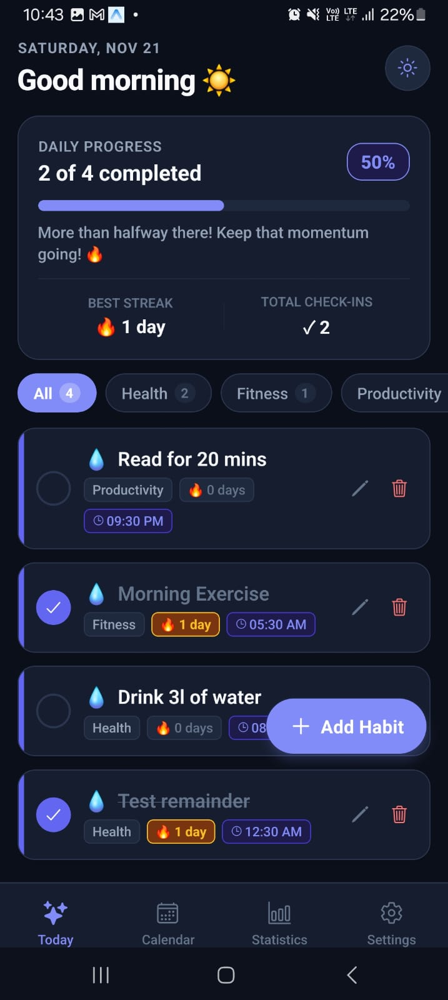
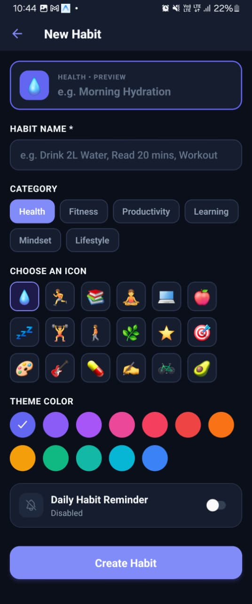
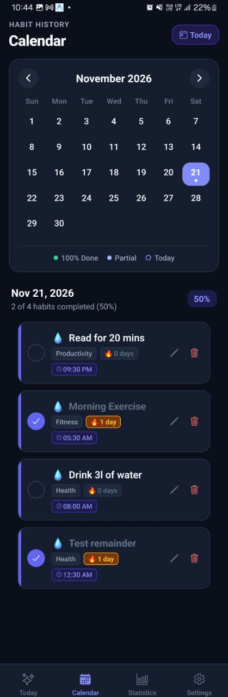
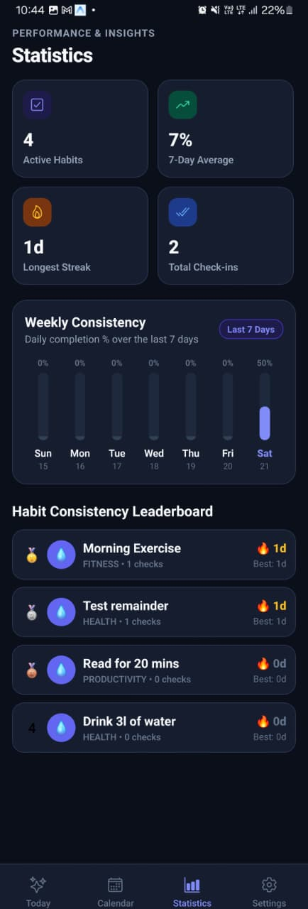
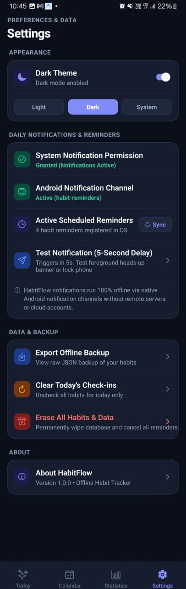

# HabitFlow – Offline Habit Tracker

**Build better habits, stay consistent, and track your progress.**

HabitFlow is an offline-first mobile habit tracking application built using React Native and Expo SDK 58. It helps users organize daily routines, maintain streaks, monitor progress, and receive scheduled reminders without requiring an internet connection for everyday habit tracking.

## Key Features

- **Habit Management:** Create, edit, and delete personal habits.
- **Daily Dashboard:** View habits and track daily completion.
- **Streak Tracking:** Monitor consistency and habit streaks.
- **Calendar View:** Review habit completion history.
- **Progress Statistics:** Visualize habit performance and completion progress.
- **Daily Reminders:** Schedule local notifications for individual habits.
- **Reminder Settings:** Update or disable scheduled reminders.
- **Offline Storage:** Store habit data locally using AsyncStorage.
- **Mobile-Friendly Interface:** Navigate between screens using bottom tabs and stack navigation.

## Technology Stack

| Technology | Purpose |
|---|---|
| React Native 0.88.1 | Mobile application framework |
| Expo SDK 58 | Mobile development platform |
| React 19.3.0 | UI development |
| JavaScript | Application logic |
| React Navigation | Screen navigation |
| AsyncStorage | Offline data persistence |
| Expo Notifications | Local habit reminders |
| Expo Vector Icons | Interface icons |
| EAS Build | Android application builds |

## Screenshots

Explore HabitFlow's mobile interface, designed to make daily habit tracking simple and intuitive:

<p align="center">
  
  &nbsp;&nbsp;
  
  &nbsp;&nbsp;
  
</p>

<p align="center">
  
  &nbsp;&nbsp;
  
</p>

<p align="center">
  <sub><b>Today Dashboard &bull; Add / Edit Habit &bull; Monthly Calendar &bull; Statistics & Analytics &bull; Notification Settings</b></sub>
</p>

## Getting Started

### Prerequisites

- Node.js and npm
- Git
- Android device or Android emulator
- Expo development environment

### Installation

Clone the repository:

```bash
git clone https://github.com/nimasha-disanayaka/HabitTracker.git
```

Navigate to the application directory:

```bash
cd HabitTracker
```

Install dependencies:

```bash
npm install
```

Start the development server:

```bash
npx expo start
```

To launch the Android development workflow:

```bash
npm run android
```

**Note:** Native notification functionality may require a compatible Android development or preview build. Expo Go does not support every native capability.

## Android APK

HabitFlow has been built and tested on a physical Android device using an EAS preview build.

To create an Android preview build:

```bash
npx eas-cli@latest build --platform android --profile preview
```

The resulting APK can be installed on a compatible Android device.

## Offline-First Functionality

HabitFlow uses `@react-native-async-storage/async-storage` to save habit information locally.

Users can manage their habits and review locally stored progress without relying on a backend server or continuous internet connectivity.

## Local Notifications

HabitFlow integrates `expo-notifications` to support scheduled habit reminders.

Users can configure reminder times, modify notification schedules, and disable reminders when they are no longer needed.

Notification permissions must be granted on the device for reminders to appear.

## Project Structure

```text
HabitTracker/
├── assets/
├── components/
├── screens/
├── src/
│   ├── components/
│   ├── navigation/
│   ├── screens/
│   ├── services/
│   ├── storage/
│   ├── theme/
│   └── utils/
├── App.js
├── app.json
├── eas.json
├── index.js
└── package.json
```

## Development Status

The application includes implemented habit management, offline storage, calendar tracking, statistics, and local notification functionality.

An Android preview APK has been generated and tested on a physical device.

## Author

Developed by [nimasha-disanayaka](https://github.com/nimasha-disanayaka).

## Repository

[HabitFlow – GitHub Repository](https://github.com/nimasha-disanayaka/HabitTracker)